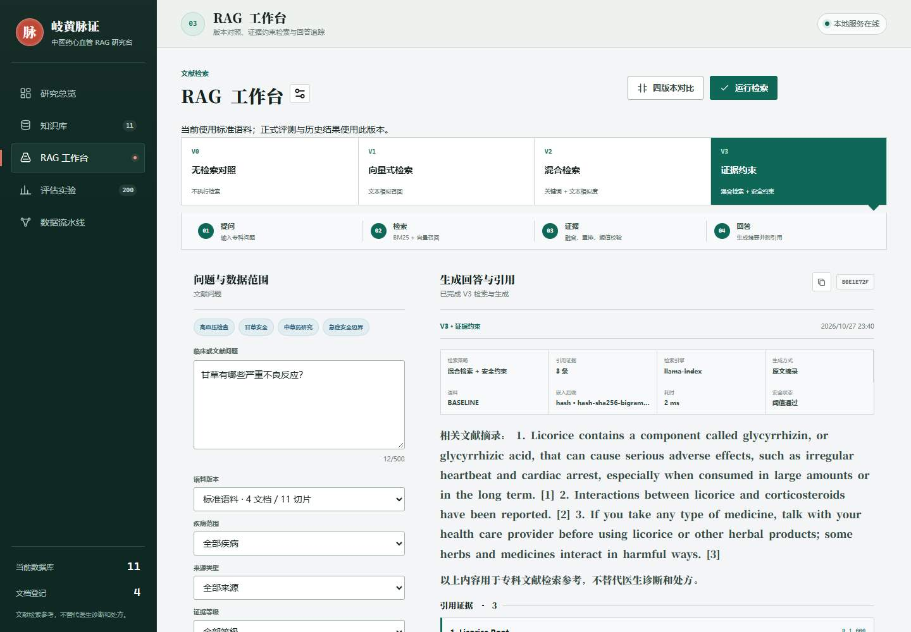
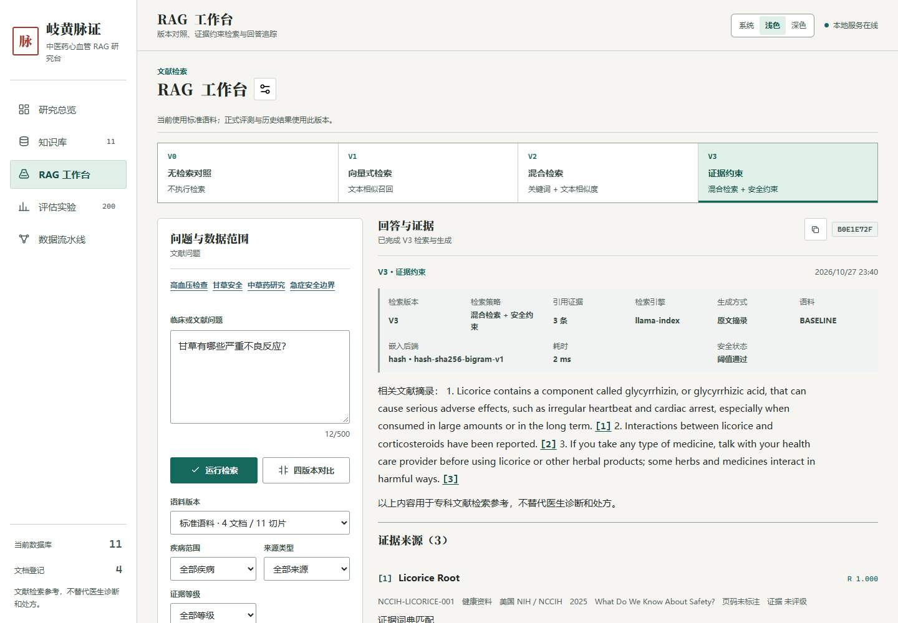
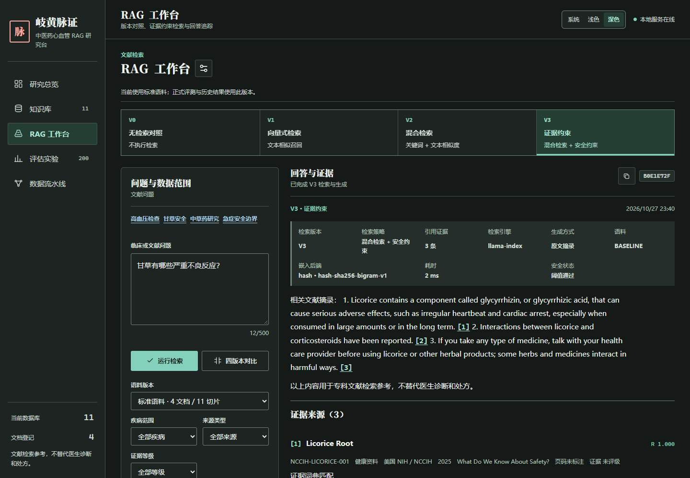

# 岐黄脉证界面改版

日期：2026-10-27。范围仅为原生前端、界面测试、截图与交付文档。不修改 API、检索、安全规则、正式 50 题及其标签，不读取或运行 holdout。

## 工作区与提交边界

开始时工作区不干净。已有 README、后端实现、Java/Python 测试、服务探测工具与相关文档改动均属于用户已有工作，本次不回退、不提交。README 使用增量暂存，只包含界面说明改动。每个实施阶段独立提交。

## Skill 安装

- 来源：<https://github.com/anthropics/skills/tree/main/skills/frontend-design>
- 仓库提交：`dbd4588f9e1033efb41dad4bef2f7947c8993d44`。
- 检查：用户目录 `C:/Users/联想/.codex/skills` 和系统 skill-installer 存在；项目初始没有技能目录。联网浅克隆成功。
- 官方安装器优先执行：首次审批超时，缩小至项目目录后重试；下载因 `IncompleteRead` 中断，未伪报成功。
- 回退：`git clone --depth 1 https://github.com/anthropics/skills.git .tmp/anthropic-skills`，复制完整 `skills/frontend-design` 到项目 `skills/frontend-design`。已确认 `SKILL.md` 和 `LICENSE.txt` 存在并阅读；未运行该 skill 中任何脚本。安装成功。
- 未安装可选第三方规范 skill：官方文档足够覆盖本任务，避免扩大信任与依赖范围。

采用原则：从中医药公开文献研究场景出发；字体承担文化气质，布局承担研究信息；仅真实流程使用顺序编号；边界、分隔线与引用编号传递含义，不作装饰；克制动效；空状态和失败状态提供具体下一步；先建立令牌再逐视图截图自检。

设计复核：遵循用户指定的米白纸面、墨色、松石绿及警示朱砂，不将全部界面染成米黄或绿色。主导航采用中性纸面，答案保持高对比阅读区，数据与来源有独立层级。保留研究工作台而非新建营销首页；保留现有本地图标，不引入图片、字体 CDN 或新框架。

## 设计令牌

| 令牌 | 浅色 | 深色 | 用途 |
| --- | --- | --- | --- |
| `--canvas` | `#f6f5f1` | `#151918` | 纸面 / 工作区 |
| `--surface` | `#ffffff` | `#1e2422` | 答案与控件 |
| `--surface-raised` | `#f0f3f2` | `#262e2b` | 元信息与表头 |
| `--ink` | `#202925` | `#eef3f0` | 主要文字 |
| `--muted` | `#52635c` | `#b3c4bb` | 次级文字，保持 AA |
| `--primary` | `#15685c` | `#83d1bb` | 松石绿，选中与来源 |
| `--cinnabar` | `#a6372b` | `#ffada3` | 拒答与警示 |
| `--info` | `#315e78` | `#a5cde5` | 图表的独立信息色 |
| `--amber` | `#785516` | `#e7c782` | 本地回退 / 状态 |
| `--focus` | `#176da0` | `#9cdbff` | 键盘焦点 |
| `--radius` | `6px` | `6px` | 控件与重复条目 |
| `--font-display` | 系统宋体 / 思源宋体 / serif | 相同 | 标题 |
| `--font-body` | 系统中文无衬线 | 相同 | 正文 |
| `--font-data` | Cascadia Code / Consolas / monospace | 相同 | 数值与引用编号 |

颜色只在 tokens 分区定义。浅深主题跟随系统，手动选项为系统、浅色、深色；仅主题选择写入 localStorage，读写均 try/catch。使用 180ms 过渡，reduce 模式完全禁用动画和过渡。

## 不得丢失的功能

实际五个主视图为研究总览、知识库、RAG 工作台、评估实验、数据流水线。模型配置为工作台对话框，V0–V3 对比为工作台子界面，不用重命名破坏现有功能。

| 界面 / 功能 | 必须保留 | 验证入口 |
| --- | --- | --- |
| 研究总览 | 文档 / 片段 / 主题 / A 级 / 长度指标，疾病与来源分布，证据等级环图，流水线与安全声明 | 五视图截图、冒烟、审计 |
| 知识库 | 语料、关键词、疾病、来源、证据筛选；重置；文档与片段选择、详情、来源链接、词典标签与元数据来源 | 冒烟筛选、链接、详情；审计 |
| 问答输入 | 示例问题、500 字计数、疾病 / 来源 / 等级、V0–V3、BASELINE / EXPANDED 同步切换、快捷提交 | 冒烟、审计 |
| 答案 | 原文摘录 / 模型模式、复制、回答段落、编号对应引用、拒答原因、急症就医提示 | 冒烟拒答、模型测试、注入审计 |
| 证据来源 | `[n]`、文献标题、机构 / 来源、年份、章节 / 页码、等级、原文、相关分、片段详情、原始来源链接 | 引用审计与截图 |
| 运行信息 | 引擎、检索版本、策略、生成方式、语料、嵌入后端与模型、耗时、引用数、证据充分性 | 冒烟运行信息断言 |
| 本地回退 | `java-local` 与“已使用本地引擎”明确可见，不隐藏远程失败 | 既有回退冒烟 |
| 检索与安全观测 | 词法 / 向量候选、融合、入选、执行 notes、参考分、拒答状态 | 截图与冒烟 |
| 版本对比 | 同题 V0–V3 并排、逐版答复 / 拒答、候选与引用、逐版证据、回退与运行信息；窄屏堆叠 | 既有对比冒烟、专用截图 |
| EXPANDED | 同步知识库 / 工作台，扩充语料数量与非正式历史评测提醒 | 既有 EXPANDED 冒烟 |
| 评估 | 正式 50 题 × 4 版 = 200 行；默认 V3 的 50 行；全版本切换；Hit@1 / @3、MRR、覆盖、拒答准确、耗时、失败分析、已有图表 | 原评估冒烟 + 审计 |
| 模型配置 | 对话框、模式、接口、模型、密钥、连接测试、明确发送同意、保存 / 清除、密钥不入浏览器存储、Escape 返回焦点 | 原模型冒烟与审计 |
| 数据流水线 | 加工状态、来源台账、授权说明、全部导入字段、校验、登记和索引、失败后保留表单 | 导入注入审计 |
| 通用状态 | 加载、无结果、错误、重试、服务在线 / 离线、toast、键盘焦点、无横向溢出、主题切换 | ui-audit |

不新增统计置信区间或医学评价数据：API 未提供的区间不虚构；样本数与各版结果清楚展示。

## 截图

改版前 4 宽度、改版后 4 宽度 × 2 主题；五个主视图及对比、模型配置子界面均覆盖。采用本地 Playwright JPEG 截图，实际压缩大小由审计脚本验证，不使用虚构图片。

改版前：28 张，共 **1,657,057 bytes**；改版后：56 张，共 **3,478,412 bytes**。全部单张小于 300,000 bytes，分别低于 3 MB / 6 MB。原始尺寸与字节数记录在 `ui-redesign/before/manifest.json` 和 `ui-redesign/after/manifest.json`。

before 来自真实本地服务；after 来自同一标准语料的已捕获协议回放，问答与评测数据不变。截图是视口截图，表格的容器滚动与视口下方控件另外由 DOM / 键盘审计覆盖。不会把回放截图解释为新的检索、生成或医学效果证据。

| 改版前工作台 | 改版后浅色 | 改版后深色 |
| --- | --- | --- |
|  |  |  |

全部截图并排索引：

| 界面 | 宽度 | Before | After 浅色 | After 深色 |
| --- | ---: | --- | --- | --- |
| 研究总览 | 1440 | [前](ui-redesign/before/overview-1440.jpg) | [浅](ui-redesign/after/overview-1440-light.jpg) | [深](ui-redesign/after/overview-1440-dark.jpg) |
| 研究总览 | 1280 | [前](ui-redesign/before/overview-1280.jpg) | [浅](ui-redesign/after/overview-1280-light.jpg) | [深](ui-redesign/after/overview-1280-dark.jpg) |
| 研究总览 | 390 | [前](ui-redesign/before/overview-390.jpg) | [浅](ui-redesign/after/overview-390-light.jpg) | [深](ui-redesign/after/overview-390-dark.jpg) |
| 研究总览 | 320 | [前](ui-redesign/before/overview-320.jpg) | [浅](ui-redesign/after/overview-320-light.jpg) | [深](ui-redesign/after/overview-320-dark.jpg) |
| 知识库 | 1440 | [前](ui-redesign/before/knowledge-1440.jpg) | [浅](ui-redesign/after/knowledge-1440-light.jpg) | [深](ui-redesign/after/knowledge-1440-dark.jpg) |
| 知识库 | 1280 | [前](ui-redesign/before/knowledge-1280.jpg) | [浅](ui-redesign/after/knowledge-1280-light.jpg) | [深](ui-redesign/after/knowledge-1280-dark.jpg) |
| 知识库 | 390 | [前](ui-redesign/before/knowledge-390.jpg) | [浅](ui-redesign/after/knowledge-390-light.jpg) | [深](ui-redesign/after/knowledge-390-dark.jpg) |
| 知识库 | 320 | [前](ui-redesign/before/knowledge-320.jpg) | [浅](ui-redesign/after/knowledge-320-light.jpg) | [深](ui-redesign/after/knowledge-320-dark.jpg) |
| 问答工作台 | 1440 | [前](ui-redesign/before/workbench-1440.jpg) | [浅](ui-redesign/after/workbench-1440-light.jpg) | [深](ui-redesign/after/workbench-1440-dark.jpg) |
| 问答工作台 | 1280 | [前](ui-redesign/before/workbench-1280.jpg) | [浅](ui-redesign/after/workbench-1280-light.jpg) | [深](ui-redesign/after/workbench-1280-dark.jpg) |
| 问答工作台 | 390 | [前](ui-redesign/before/workbench-390.jpg) | [浅](ui-redesign/after/workbench-390-light.jpg) | [深](ui-redesign/after/workbench-390-dark.jpg) |
| 问答工作台 | 320 | [前](ui-redesign/before/workbench-320.jpg) | [浅](ui-redesign/after/workbench-320-light.jpg) | [深](ui-redesign/after/workbench-320-dark.jpg) |
| 评估实验 | 1440 | [前](ui-redesign/before/evaluation-1440.jpg) | [浅](ui-redesign/after/evaluation-1440-light.jpg) | [深](ui-redesign/after/evaluation-1440-dark.jpg) |
| 评估实验 | 1280 | [前](ui-redesign/before/evaluation-1280.jpg) | [浅](ui-redesign/after/evaluation-1280-light.jpg) | [深](ui-redesign/after/evaluation-1280-dark.jpg) |
| 评估实验 | 390 | [前](ui-redesign/before/evaluation-390.jpg) | [浅](ui-redesign/after/evaluation-390-light.jpg) | [深](ui-redesign/after/evaluation-390-dark.jpg) |
| 评估实验 | 320 | [前](ui-redesign/before/evaluation-320.jpg) | [浅](ui-redesign/after/evaluation-320-light.jpg) | [深](ui-redesign/after/evaluation-320-dark.jpg) |
| 数据流水线 | 1440 | [前](ui-redesign/before/pipeline-1440.jpg) | [浅](ui-redesign/after/pipeline-1440-light.jpg) | [深](ui-redesign/after/pipeline-1440-dark.jpg) |
| 数据流水线 | 1280 | [前](ui-redesign/before/pipeline-1280.jpg) | [浅](ui-redesign/after/pipeline-1280-light.jpg) | [深](ui-redesign/after/pipeline-1280-dark.jpg) |
| 数据流水线 | 390 | [前](ui-redesign/before/pipeline-390.jpg) | [浅](ui-redesign/after/pipeline-390-light.jpg) | [深](ui-redesign/after/pipeline-390-dark.jpg) |
| 数据流水线 | 320 | [前](ui-redesign/before/pipeline-320.jpg) | [浅](ui-redesign/after/pipeline-320-light.jpg) | [深](ui-redesign/after/pipeline-320-dark.jpg) |
| 四版本对比 | 1440 | [前](ui-redesign/before/comparison-1440.jpg) | [浅](ui-redesign/after/comparison-1440-light.jpg) | [深](ui-redesign/after/comparison-1440-dark.jpg) |
| 四版本对比 | 1280 | [前](ui-redesign/before/comparison-1280.jpg) | [浅](ui-redesign/after/comparison-1280-light.jpg) | [深](ui-redesign/after/comparison-1280-dark.jpg) |
| 四版本对比 | 390 | [前](ui-redesign/before/comparison-390.jpg) | [浅](ui-redesign/after/comparison-390-light.jpg) | [深](ui-redesign/after/comparison-390-dark.jpg) |
| 四版本对比 | 320 | [前](ui-redesign/before/comparison-320.jpg) | [浅](ui-redesign/after/comparison-320-light.jpg) | [深](ui-redesign/after/comparison-320-dark.jpg) |
| 模型配置 | 1440 | [前](ui-redesign/before/model-1440.jpg) | [浅](ui-redesign/after/model-1440-light.jpg) | [深](ui-redesign/after/model-1440-dark.jpg) |
| 模型配置 | 1280 | [前](ui-redesign/before/model-1280.jpg) | [浅](ui-redesign/after/model-1280-light.jpg) | [深](ui-redesign/after/model-1280-dark.jpg) |
| 模型配置 | 390 | [前](ui-redesign/before/model-390.jpg) | [浅](ui-redesign/after/model-390-light.jpg) | [深](ui-redesign/after/model-390-dark.jpg) |
| 模型配置 | 320 | [前](ui-redesign/before/model-320.jpg) | [浅](ui-redesign/after/model-320-light.jpg) | [深](ui-redesign/after/model-320-dark.jpg) |

## 实施对照

| 阶段 | 改动 | 提交 |
| --- | --- | --- |
| Skill | 官方指引完整安装、来源记录 | `38630d9` |
| 现状 | 功能盘点、28 张前截图、本地协议与预览器 | `9a5c7e0` |
| 1 | tokens / base、字体、两套语义色 | `ab120ec` |
| 2 | 全局导航、响应布局、主题控制、研究声明 | `19b34c8` |
| 3 | 问题输入、答案、引用、拒答、回退与元信息 | `260048c` |
| 4 | V0–V3 对比、知识筛选与来源详情 | `89f2208` |
| 5 | 评测表格、既有图表、模型配置与来源登记 | `30f50fc` |
| 6 | 加载 / 空 / 错误 / 重试、busy、焦点恢复 | `a6ea603` |
| 7 | 删除旧类与无效渲染、主题属性冲突和对比度修正 | `e8c6828` |
| 测试 | 离线审计、56 张后截图、隔离工具与打包限制测试 | `44fe1d5` |

样式按 tokens → base → layout → components → views 分区，保留级联顺序以避免功能回归。清理的是没有 HTML / JS 使用方的旧类、无效总览渲染和已被覆盖的侧栏渐变，不移除现有评测环图使用的定量 conic-gradient。没有远程字体、图片、CDN、构建工具或框架依赖。

保留功能对照：上表清单全部仍有对应 DOM / 交互入口；标准语料与 EXPANDED 筛选、来源 URL、引用原文、拒答、四版本、200 行 / 默认 V3 50 行由原冒烟和审计覆盖。模型协议与密钥隔离由原模型冒烟覆盖；导入标题、详情、来源台账和空状态由离线合成案例覆盖。无需更改选择器，两个既有冒烟文件没有任何编辑、断言删除或弱化。

## 测试与结果

| 检查 | 当前结果 | 证据 / 范围 |
| --- | --- | --- |
| 既有 UI 冒烟 | PASS | 真实本地预览 / Java / Python；所有原断言保留 |
| 既有模型冒烟 | PASS | 隔离 Java + 原脚本本机 mock provider；安全配置没有覆盖 |
| 离线 UI 审计 | PASS | `ui-redesign/after/audit-report.json`，56 场景截图及额外状态 |
| Maven | BUILD SUCCESS | 155 tests，0 failure / 0 error，5 opt-in skipped |
| pytest | PASS | 113 passed，0 failure / error，1 个已有依赖弃用警告；冻结相关模块排除 |
| UI 打包单元测试 | PASS | 4 tests：白名单、排除项、单张上限、before / after 总量上限 |
| 交付归档 | PASS | 529 个源文件 / 证据条目；84 张截图符合精确白名单；排除项及未列入证据均为 0 |

审计范围：

- 7 个界面 × 4 宽度 × 2 主题，根页面严格 `scrollWidth <= clientWidth`，对话框同样检查；宽表格局部滚动。
- JavaScript error、console error、requestfailed、外部地址、未定义协议请求均为 0。
- 从实际 computed styles 取前景与祖先背景、透明度合成，使用 WCAG 线性化相对亮度公式。普通文字 4.5:1、大字 3:1；禁用控件按 WCAG 豁免并单独计数。累计 3,607 组样式样本，最低 5.4:1，不达标清单为空。
- 对当前可见的按钮、链接、表单、summary、可编辑元素及 tabindex 控件实际按 Tab；被意外设为负 tabindex 的自然交互元素不会被过滤。累计 1,663 个场景内目标全部可达，`:focus-visible` 的 outline / box-shadow 可见。
- 浅深主题均覆盖拒答、本地回退、错误重试和加载 busy；另外展开版本原文、片段和来源详情。reduce 模式的 animation-name 为 none、transition-duration 为 0。
- 问题和导入标题含 `` 时，答案、知识文档及来源台账显示字面文本；无注入 img / onerror / alert。`app.js`、`theme.js` 无动态 HTML 注入 sink。
- 主题手动保存、系统变化和 localStorage 读写被禁止时均正常。

原有主冒烟另有真实链路的远程检索、回退、503 模拟与错误恢复检查。离线审计的错误 envelope 返回 HTTP 200 / 错误业务码，测试状态不制造失败的网络请求。回放 / 合成导入只在内存中发生，不写知识库、不新增医学数据。

本机复现命令（Node / Playwright 和 Chrome 已安装，无新依赖）：

```powershell
$env:NODE_PATH='C:\Users\联想\.cache\codex-runtimes\codex-primary-runtime\dependencies\node\node_modules'
$env:CHROME_PATH='C:\Program Files\Google\Chrome\Application\chrome.exe'
$env:APP_URL='http://127.0.0.1:8099'
node tools/smoke-ui.cjs
node tools/ui-audit.cjs

mvn -o -f backend/pom.xml -DrunHoldoutEvaluation=false test

# 隔离正在运行的 JAR，且在复制/读取前排除冻结文件
python tools/prepare_ui_test_snapshot.py
mvn -o -f .tmp/ui-test-snapshot/backend/pom.xml -DskipTests package
node tools/run_model_ui_isolated.cjs

$env:PYTHONPATH=(Resolve-Path .rag-deps).Path
$env:PYTHONIOENCODING='utf-8'
$env:HF_HUB_OFFLINE='1'
$env:TRANSFORMERS_OFFLINE='1'
Push-Location .tmp/ui-test-snapshot/rag-service
python -m pytest -q -p no:cacheprovider --ignore=tests/test_safety_rules_shared.py --basetemp=../.tmp/ui-pytest-final --junitxml=../.tmp/ui-pytest-results.xml
Pop-Location

$env:TEMP=(Resolve-Path .tmp).Path
$env:TMP=$env:TEMP
python tools/test_ui_delivery.py
python tools/package_delivery.py --output .tmp/ui-delivery.zip
```

已有隔离副本时安装工具拒绝覆盖，可复用该副本；未来再验证新源码使用独立副本。现有 8081 / 8001 服务和 8099 预览未被停止，模型测试启动的 Java 与随机预览进程均由测试关闭。

失败与重试如实记录：技能下载中断后用浅克隆；旧服务上的模型连接超时后改用新构建的隔离 Java，原断言通过。首次 Python 回归有 112 passed / 1 failed，失败为运行中 JAR 无法重命名；隔离副本初次启动又缺失 pytest 临时父目录，已补齐后重跑得到 113 passed（413.49s）。打包测试的默认 Windows Temp 被拒绝后，经正常审批改在项目 `.tmp` 重跑通过。未覆盖允许列表、Origin 复核、凭据同意或任何后端断言。

机器可读汇总见 [test-results.json](ui-redesign/test-results.json)，包含原冒烟文件 SHA-256、通过项、失败历史、排除项及真实 / 回放边界。既有服务探测与本次前端回归是不同实验，未更改其原有结论。

交付归档 `.tmp/ui-delivery.zip` 由原打包工具生成，仅用于本机核验，不提交二进制归档。检查 ZIP 条目与 `delivery-manifest.json`，确认 `.tmp`、运行目录、构建产物、依赖、冻结文件及未列入白名单的 UI 证据均未进入归档。28 张 before 共 1,657,057 bytes，56 张 after 共 3,478,412 bytes，全部单张低于 300,000 bytes。最终文档提交后再次生成并核验归档。

## 未完成项

真实外部模型 / `tools/smoke-live-model.cjs` 未验证：本次不使用真实凭据或付费外部请求；本机兼容协议 mock 不能代替厂商实测。

holdout 未读取、未运行；`tests/test_safety_rules_shared.py` 因包含盲测命名及导入级数据读取被排除，不把允许测试集称为无条件全量 pytest。Maven 的冻结评测及其他 opt-in 测试保持跳过。不会为了前端任务启用这些评测。

可选后续增强：在获得合规模型测试环境后验证厂商协议，补充人工读屏器检查。没有要求用户手工完成的交付步骤。
