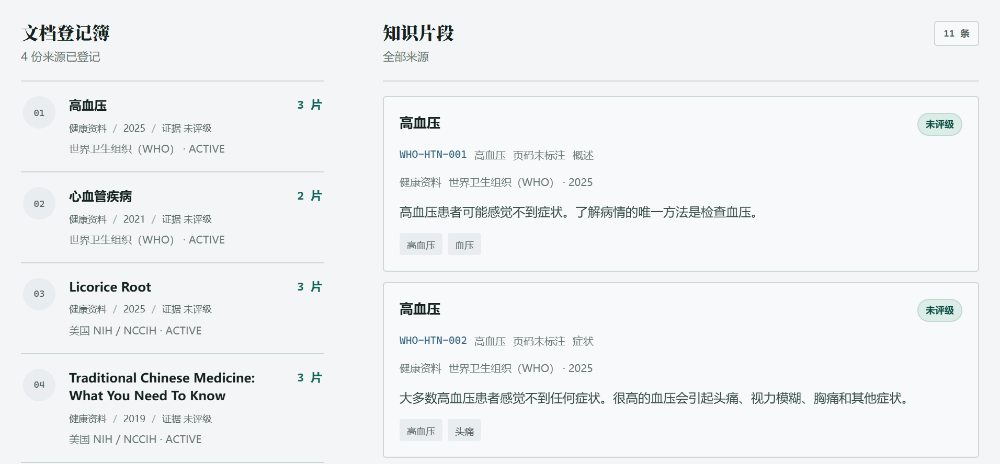
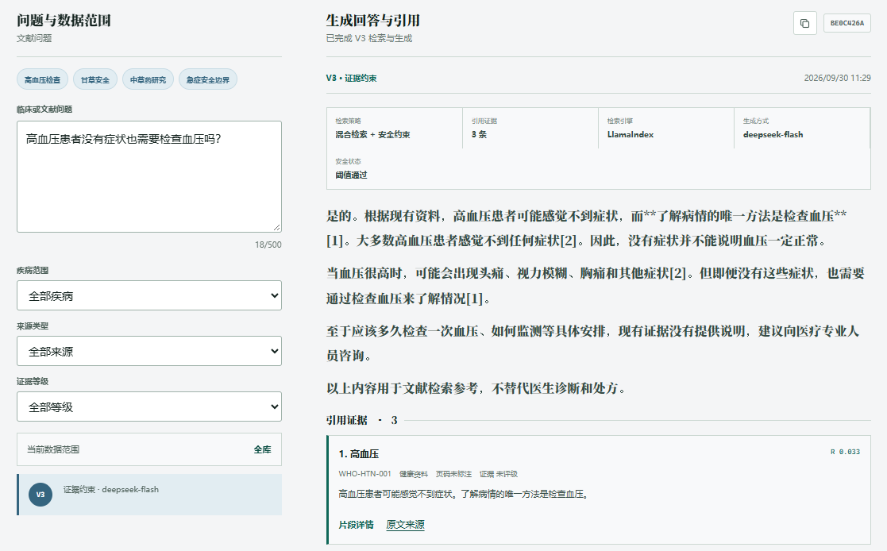
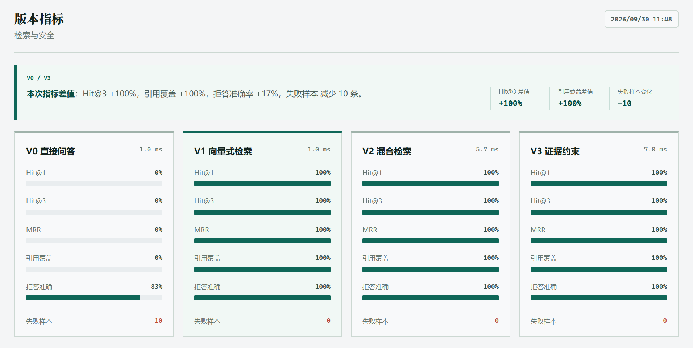

# 岐黄脉证项目简要介绍

以中医药与心血管相关公开资料为实验领域。

# 一、项目简介

本项目名为“岐黄脉证”，定位为面向专业领域公开资料的证据检索与问答 RAG 原型，以中医药和心血管相关公开资料为实验领域。用户可以提出问题，并查看回答所依据的原文和来源。项目重点研究混合检索、候选证据筛选、证据覆盖约束、引用追溯与可评测性，用于毕业设计研究与演示。本系统仅用于公开资料检索、证据组织与研究型问答实验，不用于疾病诊断、治疗方案制定、处方建议或临床决策；系统输出应结合原始资料进行人工核验。

# 二、项目背景

相关健康资料分散在不同网站，人工查找和核对比较费时；单独向大模型提问，又不容易确认答案依据。因此，项目把有明确来源的资料整理成知识库，让系统先找到相关原文，再组织回答，方便用户回到资料中核对。

# 三、项目主要功能

- **前端工作台。** 系统包含研究总览、知识库、RAG 工作台、评估实验和数据流水线五个页面。用户可以直接进入，目前没有登录和角色权限功能。
- **文本导入与处理。** 填写来源、授权信息并粘贴正文后，系统进行文本切分、保存和索引更新。当前支持文本导入，不支持直接解析 PDF、Word 或扫描件。
- **知识库管理。** 内置 4 份公开资料、11 条原文摘录，来自 WHO 和美国 NIH/NCCIH。可以筛选知识片段，查看来源、章节和原文链接；资料没有被标为已获临床证据评级。
- **RAG 检索。** 支持文本相似度检索、关键词与相似度混合检索，以及增加证据约束的版本。页面显示检索片段、候选数量和处理耗时。
- **大模型与对话。** 已接入 DeepSeek，能够结合检索片段生成带引用的中文回答；未启用模型时返回原文摘录。目前是单轮问答，没有历史会话保存或多轮上下文记忆。
- **版本对比与评估。** 同一问题可进行四版本对比；当前正式评测集包含 50 个问题，按 4 个版本执行共 200 条评测结果，用于检查检索命中、证据覆盖、引用和拒答表现。V0 只输出固定提示，不是大模型直接回答；对比与评估不使用工作台的会话模型配置。P2-02-3 Experiment A 当前冻结为 PASS，`failureCount = 1`；完整正式结果见[实验基线记录](evaluation-baseline.md)。
- **安全边界。** 对规则识别到的急症、个体处方等问题进行拦截，模型生成前还会检查证据是否充分。这是有限的规则防护，不能替代医生判断。

图 1　知识库页面局部：文档来源与“高血压”相关原文片段。

# 四、技术架构

| 层次 | 当前使用的技术及作用 |
| --- | --- |
| 前端 | 原生 HTML、CSS、JavaScript，负责页面、表单和结果展示，未使用 Vue 或 React。 |
| 后端 | Java 17 编译目标、Spring Boot 3.3、Maven，负责接口、业务编排、参数校验和知识登记。 |
| RAG 服务 | Python、FastAPI、LlamaIndex，负责知识片段索引和检索，通过 HTTP 与 Java 通信。 |
| 检索方法 | BM25 与本地哈希特征向量混合召回，经过候选预过滤、Weighted RRF、metadata rerank 和 Evidence Coverage Gate。当前向量并非预训练语义模型。 |
| 大模型 | DeepSeek API，已实测模型为 deepseek-flash；由 Java 把问题和命中片段交给模型。 |
| 数据存储 | JSON 文件、导入快照和内存索引。 |
| 部署与测试 | 提供 Dockerfile 和 Docker Compose 配置，以及 Java、Python 自动测试。本轮已验证本机运行，容器配置通过校验，未重新验收容器启动。 |

整体由“浏览器 → Java 业务服务 → Python 检索服务”协同完成；系统也保留 Java 本地 RAG Engine。两条路径用于原型运行与检索契约验证，Retrieval Contract 交叉验证关键行为，不表示所有实现细节完全一致。回答可由 Java 基于最终证据组织为原文摘录，或在配置启用时调用模型生成。

# 五、RAG问答流程

**用户 Query → 预处理与 Tokenization → BM25 + 向量混合召回 → 候选预过滤 → Weighted RRF → metadata rerank → Evidence Coverage Gate → 最终证据 → 回答 → Citation → Evaluation**

1. 用户在工作台输入问题，选择检索版本，也可以限定疾病或来源范围。
2. 系统先检查问题是否触发安全规则，再按所选版本从知识片段中查找相关内容。
3. 启用模型且证据充分时，Java 将本次问题和命中原文交给 DeepSeek，不发送整个知识库。
4. 模型按提供的证据生成回答，系统检查引用编号，再显示答案、原文片段和检索记录。

未启用模型时直接返回原文摘录；触发规则或证据不足时停止模型生成。引用检查只能检查编号等结构，不能保证每句话都正确，仍需核对原文。

图 2　真实 DeepSeek 问答局部：高血压检查问题、生成结果与 WHO 引用。

# 六、项目特点

- **回答有出处：** 将回答与命中原文一起展示，便于核对，而不只给一段结论。
- **检索过程可比较：** 可以观察不同版本的结果，并通过小规模评估发现问题。
- **业务与模型协同：** Java 管理业务，Python 负责检索，DeepSeek 负责组织答案。
- **输出范围有约束：** 证据不足或触发安全规则时停止生成，不将检索分数当作医学正确率。

# 七、项目整体流程

用户进入系统后，可以先浏览知识库，或登记有授权的新文本；随后在 RAG 工作台选择版本、确认模型配置并提问。系统完成检查、检索和生成后返回答案与引用，用户可以查看原文，也可以进入对比或评估页面观察不同检索方案的表现。

图 3　评估页面局部：50 个问题在 4 个版本中的评测结果（共 200 条），用于项目回归检查。

# 八、后续可扩展方向

- 扩充有授权的文献，并增加人工复核，改善知识覆盖范围。
- 引入预训练语义向量模型，扩大评测集，改进检索效果。
- 增加 PDF、Word 解析及扫描件文字识别，降低资料导入成本。
- 增加多轮对话、历史记录和用户权限，完善多人使用时的数据保护。

# 九、项目总结

项目已经串起“公开资料登记、混合检索、候选证据筛选、证据约束、回答、引用追溯和版本评估”的研究原型链路。当前知识库为 4 份文档、11 个片段；系统没有经过临床验证，不用于医疗决策。

## 给老师介绍项目时可以直接说的话

老师，这个项目叫“岐黄脉证”，是一个面向公开资料的领域证据检索与问答 RAG 原型，以中医药和心血管资料为实验领域。用户提问后，系统先用 BM25 和向量特征检索资料，再筛选证据并展示来源；需要时由 Java 把命中原文交给配置的模型组织回答。前端是网页，Java 负责接口和业务，Python 提供另一条检索服务路径。我还做了候选筛选、证据约束、引用追溯以及 50 个问题、4 个版本的回归评测。项目用于毕业设计研究与演示，不提供疾病诊断、治疗方案、处方建议或临床决策。
